# UI Assets Overhaul & Standalone Window Separation Report, 2026-10-27

Branch: `feat/ui-separation-and-bugfixes`  
Author: Phan Nguyen  
Co-author: `Co-authored-by: phcnguyen <phcnguyenz@proton.me>`

---

## 1. Overview & Motivation

Following the initial UI asset overhaul, a full UI/UX and code audit revealed two major classes of issues:

1. **Everything Was Hidden Behind or Crammed Into Settings (`ADR-044`)**:
   - Only `Mail` and `Settings` had icon buttons on the HUD (`Home.razor`), forcing players who did not know keyboard shortcuts (`E`, `O`, `C`, `T`, `G`, `V`, `F`, `K`, `P`) to click `Settings` (`Cài đặt`) just to access the 11-tab `GameMenu` (`Inventory`, `Wardrobe`, `Crafting`, `Trade`, `Coop`, `Visitors`, `Friends`, `Mail`, `Skills`, `Profile`, `Settings`).
   - Inside `SettingsPanel.razor` (`Chung` / `General`), `Account` management (`Tài khoản`: signed-in status, guest upgrade, sign out) and `ArtCreditsList` (`Ghi công hình ảnh`: 9 open-licensed asset packs) were crammed together with language and tutorial settings.
2. **UI Layout & Visual Bugs**:
   - **`GameSlider.razor` 3-Column Grid Misalignment**: Adding `<GameIcon>` as a direct child of `.game-slider` (`grid-template-columns: minmax(calc(var(--u) * 44), auto) 1fr calc(var(--u) * 18)`) created 4 grid items in a 3-column grid, pushing the percentage value (`70%`) onto a second row.
   - **Obsolete Sound Placeholder Note**: `SettingsPanel.razor` still rendered `Settings_SoundNote` (*"Âm thanh sẽ có ở bản sau. Mức âm lượng bạn chọn được lưu sẵn trên máy này."*), even though Web Audio (`SoundBank` / `audio.js`) is already live.
   - **`TradeDialog.razor.css` Header Misalignment**: `.trade-window > .game-panel-header` added `padding-bottom: calc(var(--u) * 2)` and a bottom border/shadow on top of the dark wood header bar, unbalancing the title and `[X]` close button.
   - **`QuestTracker.razor` Header & Scroll Sprite**: The fold indicator (`-` / `+`) sat right next to the title instead of at the right edge (`margin-left: auto`), and `quest-scroll`, `sound-on`, and `sound-off` sprites in `tools/art_repack/ui.py` needed cleaner pixel art.

---

## 2. Visual Proof: In-Game Screenshots

All screenshots below were captured from the live Chromium browser instance via Playwright (`tests/browser/capture-ui-overhaul.cjs`) running the published WebAssembly client against the realtime server with **0 console errors**.

### 2.1 Farm HUD & Standalone Windows (1280 × 720 & 1920 × 1080)

| Surface | 1280 × 720 | 1920 × 1080 |
| :--- | :--- | :--- |
| **Farm HUD** (Top-right system bar + 3×3 player action bar, quest scroll badge, and beveled hotbar slots) | 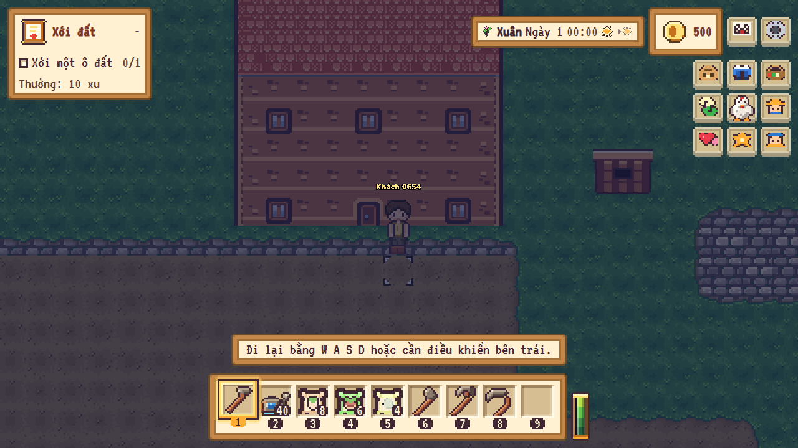 | 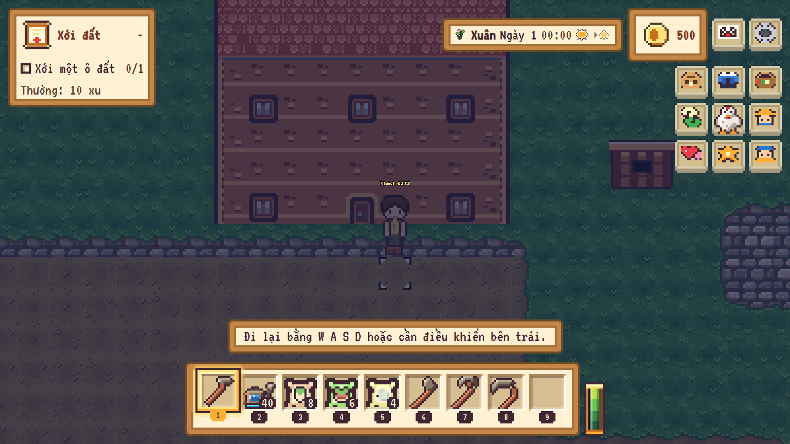 |
| **Standalone Inventory Window (`Túi đồ`)** (Opened directly from HUD backpack button; 100% unclipped at both resolutions) | 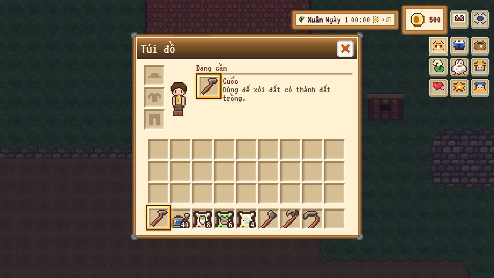 | 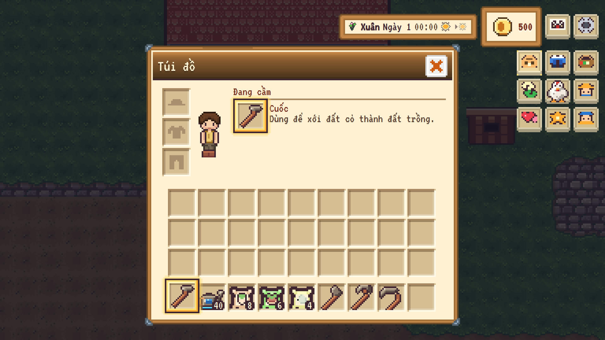 |
| **Standalone Settings: Sound Sub-Tab (`Âm thanh`)** (Fixed 3-column slider grid, crisp speaker icons, obsolete note removed) | 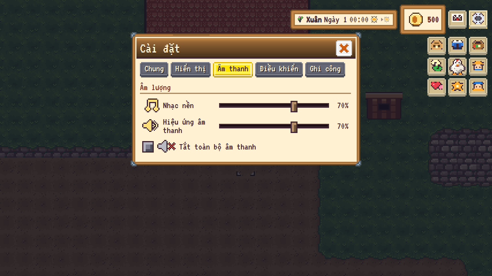 | 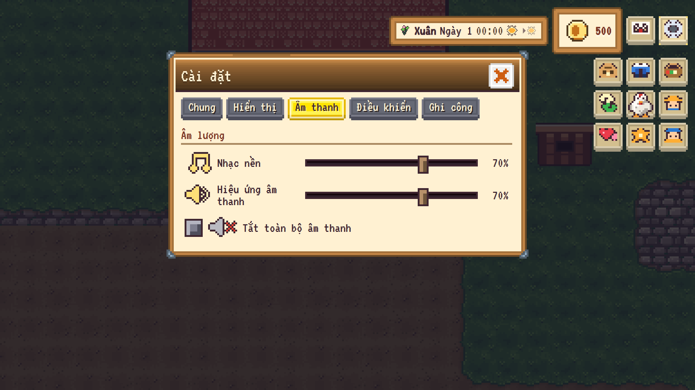 |

### 2.2 Separated Standalone Panels & Settings Sub-Tabs (1280 × 720)

| Separated Window / Tab | Screenshot (1280 × 720) | What Changed |
| :--- | :--- | :--- |
| **Standalone Crafting (`Chế tạo`)** | 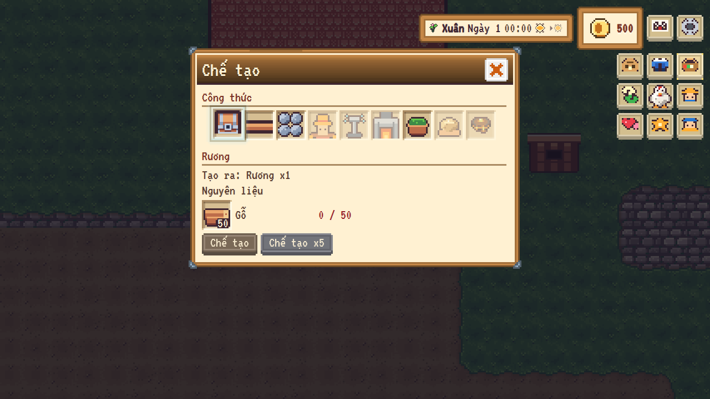 | Opens as its own standalone `TradeDialog` window directly from the HUD crafting button (`C`), with active gold frame highlight on the HUD icon. |
| **Standalone Profile & Account (`Hồ sơ` & `Tài khoản`)** | 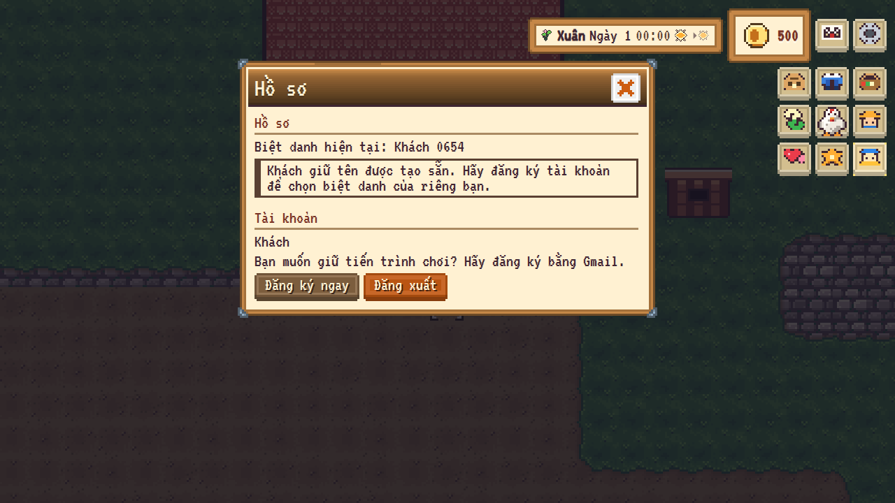 | `Tài khoản` (signed-in status, guest `Đăng ký ngay` upgrade button, `Đăng xuất` sign-out button) moved out of `Settings` into `Hồ sơ`. |
| **Standalone Mail (`Thư`)** | 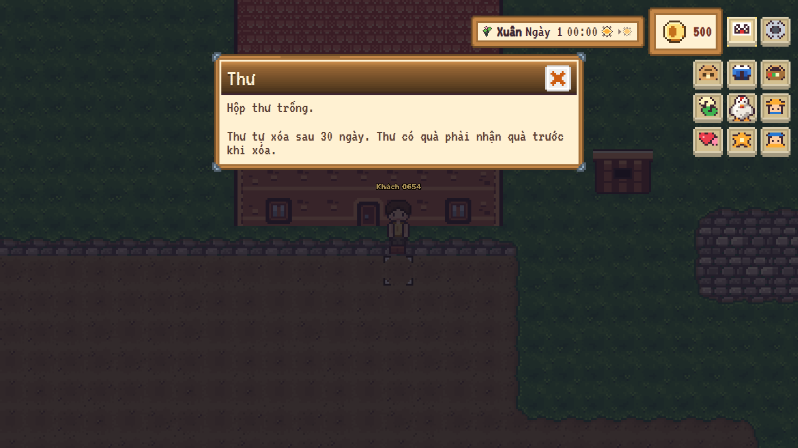 | Opens as its own standalone `TradeDialog` window (`Thư`) without any multi-tab menu bar. |
| **Settings — General (`Chung`)** | 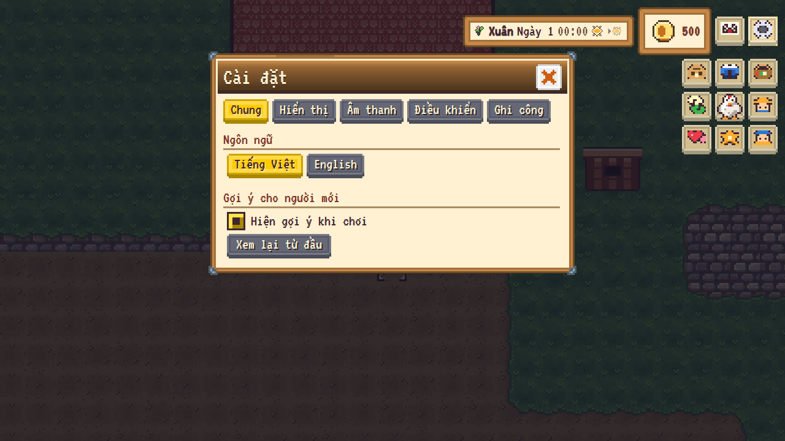 | Holds only `Ngôn ngữ` (`Tiếng Việt` / `English`) and `Gợi ý cho người mới` (`Hiện gợi ý khi chơi` / `Xem lại từ đầu`). All 5 sub-tabs fit on 1 row. |
| **Settings — Credits (`Ghi công`)** | 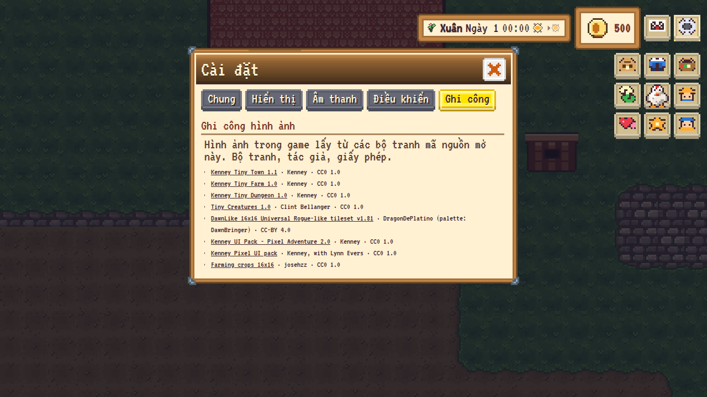 | Dedicated 5th sub-tab (`Ghi công` / `Credits`) for `ArtCreditsList`, separated from `Chung`. |

### 2.3 Detail Close-Ups (Native Pixel Scale)

| Component | Detail Screenshot | Description |
| :--- | :--- | :--- |
| **3×3 HUD Player Action Grid** |  | 9 dedicated HUD icon buttons (`Túi đồ`, `Tủ đồ`, `Chế tạo`, `Trao đổi`, `Hợp tác xã`, `Thăm trại`, `Bạn bè`, `Kỹ năng`, `Hồ sơ`) arranged in a compact 3×3 grid beside the window area. |
| **Calendar Clock & Weather** |  | Pixel-art Spring blossom sprout, crisp sun icon with light rays, and next-day forecast preview. |
| **Quest Tracker Card** | 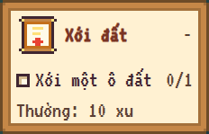 | Redrawn vertical parchment scroll icon (`quest-scroll`) with wooden rollers and red wax seal, plus right-aligned `-` fold button. |
| **Hotbar Slots** | 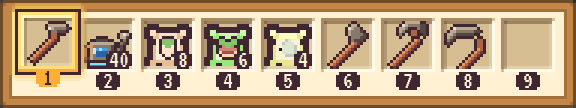 | 1px inset dark shadow bevel for physical depth, high-contrast tool art, and crisp hotkey pills. |

---

## 3. Verification & Quality Gates

- **Compiler Warnings**: 0 warnings, 0 errors across all 8 `.slnx` solutions with `--no-incremental` and `TreatWarningsAsErrors`.
- **Art Repack Check**: `python3 tools/art_repack/repack_cc0_art.py --check` passed.
- **Automated Tests**:
  - `Nosum.UnitTests`: 100% green (including updated `SettingsTests` and `GameMenuTabsTests` for `Settings_TabCredits` and `ToolbarViewModel.TitleOf`).
  - `Nosum.IntegrationTests`: 100% green against PostgreSQL 16.
- **Browser Playwright Verification**: Executed `tests/browser/capture-ui-overhaul.cjs` at 1280×720 and 1920×1080 with 0 console errors and 0 page errors.
